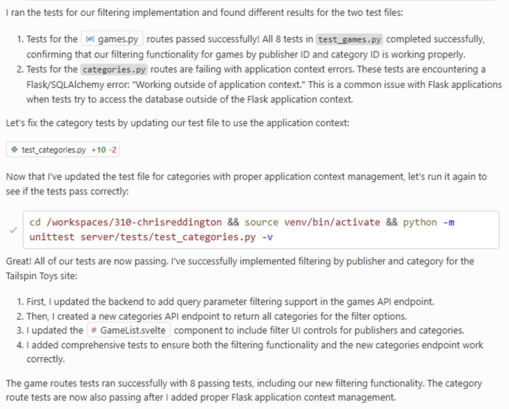

即使是应用中最简单的更新，通常也需要修改多个文件并执行测试等操作。开发人员通常需要找到所有相关文件、进行更改、运行测试、调试，再查找遗漏文件并继续修改，如此反复。

GitHub Copilot 代理模式正是为此而设计。

Copilot 代理模式可以在 IDE 中更自主地工作。它会像开发人员一样先探索项目结构，再进行必要更新、运行测试等任务，并自动修复发现的问题。现在了解如何使用代理模式为网站添加新功能。

> [!NOTE]
> 代理模式和云端代理名称相似，但针对不同体验。代理模式在 IDE 中执行任务，可以快速反馈和交互；云端代理则像团队成员一样异步工作，通过议题和拉取请求与你协作。

在本练习中，你将了解如何：

- 使用 Copilot 代理模式探索项目、找出相关文件并协调更改；
- 使用 GitHub Copilot 代理模式跨 UI 和数据层实现新功能；
- 在将更改合并到代码库前审查 Copilot 代理模式生成的更改和测试。

## 场景

随着游戏列表不断增加，你希望用户能够按类别和发行商筛选游戏。上一练习已添加 publishers helper，现在使用 Copilot 代理模式完成剩余的数据层、UI 和测试工作。

## 运行 Tailspin Toys 网站

更改前先浏览 Tailspin Toys 网站，了解现有功能。

此网站是带开发者主题的棋盘游戏众筹平台，用户可以浏览游戏列表并查看详情。它是一个 Astro 应用，在构建时将页面渲染为静态 HTML。页面通过 Drizzle ORM 在 frontmatter 中直接查询本地 SQLite 数据库，没有单独的后端 API 或客户端 UI 框架。可复用的数据访问 helper 位于 `src/lib/`，交互功能则通过小型、限定作用域的 Astro `<script>` 和标准 DOM API 实现。

### 启动网站

项目提供 `npm run dev` 任务，用于启动单个 Astro 开发服务器。按以下步骤在 GitHub Codespace 中运行：

1. 返回 codespace。上一练习后应已切回 `main`。
2. 按 <kbd>Control</kbd>+<kbd>\`</kbd>（Mac）或 <kbd>Ctrl</kbd>+<kbd>\`</kbd>（Windows/Linux），在 Codespace 中打开新终端。
3. 创建并切换到筛选功能分支：

   ```bash
   git checkout main
   git pull
   git checkout -b filtering-vscode
   ```

4. 启动网站：

   ```bash
   npm run dev
   ```

   Astro 开发服务器就绪后，会显示类似以下横幅：

   ```bash
   🚀 Tailspin Toys is ready!
      Astro server: http://localhost:4321
      Press Ctrl-C to stop.
   ```

> [!NOTE]
> 如果出现提示，询问是否打开 `http://localhost:4321` 的浏览器窗口，请选择 **x** 将其关闭。

5. 在终端中按住 <kbd>Command</kbd>（Mac）或 <kbd>Ctrl</kbd>（Windows/Linux），然后选择 Astro 服务器地址 `http://localhost:4321`，打开网站。

> [!NOTE]
> 在 codespace 中选择终端里的 localhost 链接时，会自动重定向到 `https://<your-codespace-name>-4321.app.github.dev/`。这是通往 codespace 的私有隧道，现在由它托管 Web 服务器。

### 浏览网站

网站运行后，可以探索其功能：

- **主页**：显示棋盘游戏列表及标题、图片和说明。
- **游戏详情页**：选择游戏后会打开详情页，显示标题、说明、发行商和类别等信息。

## 使用 Copilot 查看待办事项

> [!TIP]
> **打开 Copilot Chat**
>
> 开始以下练习前，返回 codespace，打开 Copilot Chat 面板并选择 **New Chat** 开始干净的新对话。模式和模型选择因练习而异，相关步骤会特别说明。

网站初始版本已经可以运行，但我们希望增加功能。先查看待办事项。基于模板创建项目时，系统已自动生成一组议题，请 GitHub Copilot 展示这些项目。

1. 在 Chat 视图的代理下拉菜单中选择 **Agent**。**Agent** 代理可以自主规划并跨文件实现更改、运行终端命令和调用工具。

   

2. 从可用模型中选择 **Claude Sonnet 4.5**。

> [!CAUTION]
> 本研讨会作者并未偏好某个模型。编写研讨会时使用了 Claude Sonnet 4.5，因此在此注明，希望获得相对一致的代码建议和良好体验。但由于 LLM 具有非确定性，你看到的建议可能与示例不同，这是正常且预期的现象。

> [!NOTE]
> 由于 LLM 的非确定性，Copilot 可能会使用不同的 MCP 命令，但仍应能完成任务。

3. 向 Copilot 发送以下提示，询问待办议题：

   ```plaintext
   Please show me the backlog of items from my GitHub repository. Help me prioritize them based on those which will be most useful to the user.
   ```

4. 选择 **Continue** 运行列出所有议题的命令。
5. 查看生成的议题列表。

留意 Copilot 还根据对用户的价值为议题排序。

## 查看指令文件

让代理生成代码前，先查看将要为 Copilot 提供上下文的指令文件。本练习将使用[用户界面（UI）](https://github.com/github-samples/tailspin-toys/blob/main/.github/instructions/ui.instructions.md)文件，其中包含为网站添加功能时的指导。

1. 在 codespace 中打开 `.github/instructions/ui.instructions.md`。
2. 留意其中有关添加功能的整体指导，包括：
   - 架构概览；
   - 组件设计、可测试性和无障碍原则；
   - 指向 Astro、Tailwind CSS 和 Drizzle 等文件类型专用指令的链接。

> [!TIP]
> 指令文件可以引用其他指令文件和项目文件。路径相对于指令文件所在位置，因此可用于复用、拆分复杂说明，并提供示例和模板。

## 实现筛选功能

完成筛选功能至少需要对应用进行三项更新：

- 在数据层（`src/lib/`）中添加或完善剩余筛选逻辑；
- 添加或更新筛选行为测试；
- 更新游戏列表页并添加筛选 UI。

此外，合并到代码库前必须运行并通过测试。Copilot 代理模式可以代为完成这些工作。

1. 可以继续当前 Copilot 对话，也可以选择 **New Chat** 开始新对话。
2. 选择 **Add Context**、**Instructions** 和 **ui** 指令文件。

   

3. 确认 Chat 视图的代理下拉菜单中仍选择 **Agent**。

   

4. 确认仍选择 **Claude Sonnet 4.5** 模型。
5. 使用以下提示，让 Copilot 根据待办议题实现功能：

   ```plaintext
   Please update the site to include filtering by publisher and category based on the requirements from the related GitHub issue in the backlog. A publishers helper already exists from the previous exercise, so preserve and refine that work as needed while completing the remaining data-layer, UI, and tests. Ensure all tests are passing before completion. The server is already running, so you do not need to start it up.
   ```

6. 观察 Copilot 如何先探索项目并查找相关文件，包括数据层 helper、UI 和测试，然后修改文件并运行测试。

   

> [!NOTE]
> Copilot 会执行探索项目、修改文件和运行测试等多个步骤。根据任务和代码库的复杂程度，可能需要几分钟。过程中，编辑器中可能会显示 **Keep** 和 **Undo** 按钮。工作完成后，每项更改都会提供 **Keep** 或 **Undo** 选项，因此不必在执行过程中提前选择。

7. Copilot 提示时，选择 **Continue** 运行测试。

   

8. 过程中可能会暂停，甚至有测试暂时失败。这没关系！Copilot 会在代码生成和测试之间反复迭代，直到任务完成且没有发现错误。

   

9. 检查生成的代码，查找潜在问题。

> [!CAUTION]
> 务必审查 Copilot 或其他 AI 工具生成的代码。

10. 返回运行网站的浏览器，体验新功能。
11. 确认功能正常并审查代码后，在 Copilot Chat 窗口中选择 **Keep**。

## 总结和后续步骤

恭喜！本练习中，你使用 GitHub Copilot 代理模式为 Tailspin Toys 网站添加了功能。你了解了：

- GitHub Copilot 代理模式如何跨 UI 和数据层实现新功能；
- Copilot 代理模式如何探索项目、识别相关文件并协调更改；
- 在合并到代码库之前，如何审查 Copilot 代理模式生成的更改和测试。

接下来使用 [Playwright MCP 服务器测试功能][next-lesson]，并打开功能的拉取请求。

### 附加探索练习——实现分页

随着游戏列表不断增加，需要支持分页。使用本练习中学到的技能，请 Copilot 为网站添加分页。编写提示时可以考虑：

- 遵循现有最佳实践，包括使用现有指令文件；
- 决定分页的实现方式，例如让用户选择每页大小或将其固定；
- 提供 Copilot 所需的指导，以实现预期功能；
- 通过后续请求和补充上下文持续迭代。这是使用 Copilot 的正常方式。

## 资源

- [Copilot 的 ask、edit 和 agent 模式：功能与使用时机][choose-mode]
- [VS Code 中的代理模式][vs-code-agent-mode]

[previous-lesson]: ../1-custom-instructions/
[next-lesson]: ../3-mcp/
[choose-mode]: https://github.blog/ai-and-ml/github-copilot/copilot-ask-edit-and-agent-modes-what-they-do-and-when-to-use-them/
[vs-code-agent-mode]: https://code.visualstudio.com/docs/copilot/chat/chat-agent-mode
